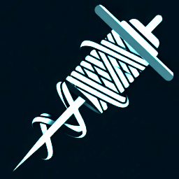
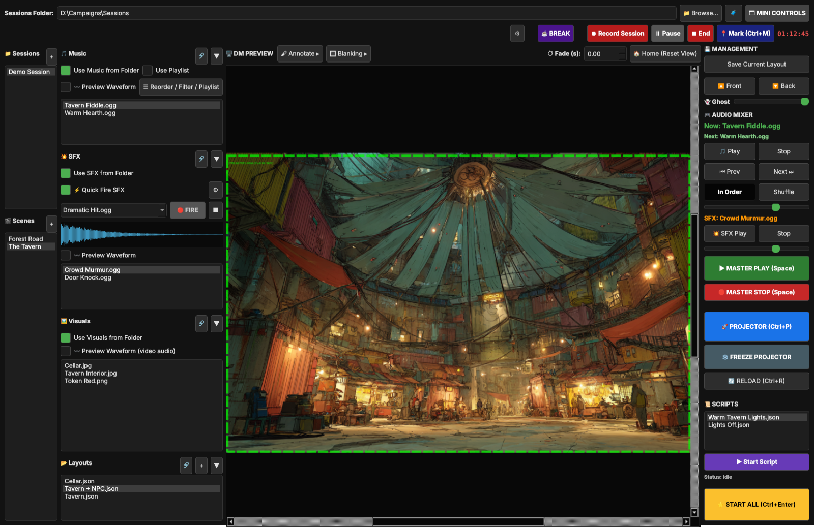
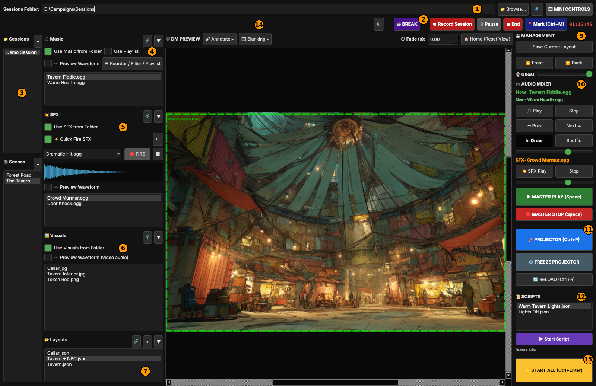
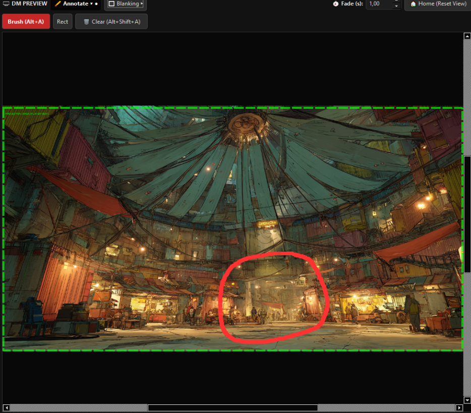
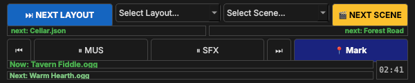
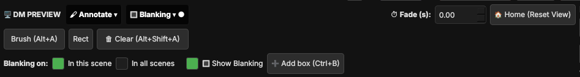
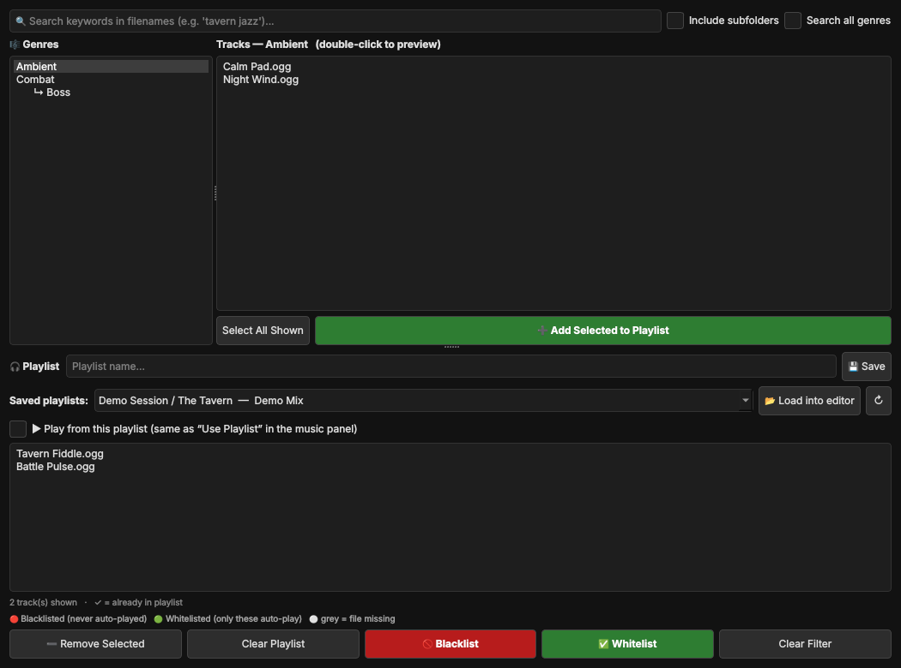
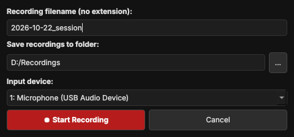

<p align="center"></p>

# WeltenWeber DM Tool

**One screen to run your whole table.** Show scene art on a projector or second screen, play music and sound effects,
fire a thunderclap at the perfect moment, switch scenes with one click and record the session, all from one window.
Built for a sci-fi D&D campaign, works for any tabletop game. Windows app, free and open source (MIT).



**[⬇️ Download for Windows](../../releases/latest)** (no installation, just unzip and start)


Full Documentation: 
https://app.notion.com/p/WeltenWeber-DM-Tool-Guide-401dbb69c39281da9587e72a966c0c0a?source=copy_link

## What it can do

* 🖼️ **Projector stage:** build layouts from images and videos, drag, scale and fade them, then show them full screen on your
  second screen. The DM preview shows exactly what your players see (the green box).
* 🎬 **Sessions and scenes:** every scene remembers its own music, sounds, visuals, layouts and volumes.
  **START ALL** starts a whole scene with one click.
* 🎵 **Music your way:** play from the scene folder, from a genre library (nested folders work), or from a saved **playlist**.
  Shuffle, reorder, blacklist or whitelist tracks, preview the waveform.
* 💥 **SFX and Quick Fire:** loop ambience like rain or a crowd, and keep a row of one-shot sounds ready on **Shift+S**.
* 🖌 **Drawing:** a brush and a rectangle for quick circles and notes on the stage, tucked into a foldable menu.
* 🔳 **Blanking (optional):** black boxes that hide the secret parts of a map. Off by default. Switch it on for one scene or for all scenes.
* ❄️ **Freeze Projector:** keep the players' picture steady while you prepare the next one in the preview.
* ☕ **Break mode:** one click swaps in a break slideshow and music, and brings your scene back afterwards.
* ⏺ **Session recording with markers:** record the table audio in safe 30-minute chunks, drop 📍 marks with **Ctrl+M**.
  Layout changes and breaks are marked for you.
* 🗔 **Mini controls:** a small always-on-top window with next scene, next layout and music buttons.
* 📜 **Light scripts:** send saved web requests (for example to smart lights) when a scene starts.
* 🧳 **Portable projects:** everything is saved with relative paths, so you can copy your sessions folder to another PC.
* 📡 **Remote control:** other tools can drive the app, see [docs/REMOTE_API.md](docs/REMOTE_API.md).

> 📖 **Full guide with every panel explained:** [Open the documentation](#documentation)

## A quick tour



| # | Where | What it does |
|---|---|---|
| 1 | Top bar | Choose your **sessions folder** with *Browse…*. 🧳 makes an older project portable. *Mini Controls* opens the small window. |
| 2 | Record and break bar | **☕ BREAK**, **⏺ Record Session**, pause, end, and **📍 Mark** |
| 3 | Sessions and scenes | Your campaign. **+** makes a new session or scene. |
| 4 | Music | Scene folder, genre library or playlist, waveform and the Reorder / Filter / Playlist window |
| 5 | SFX and Quick Fire | Looping sounds, plus one-shot sounds on a **FIRE** button |
| 6 | Visuals | Pictures and videos for this scene. Double-click to put one on the stage. |
| 7 | Layouts | Saved arrangements of visuals. Double-click to fade to one. |
| 8 | DM preview | Your stage. Drag and scale things here. The green box is what the players see. |
| 9 | Management | Save the current layout, move things to the front or back, and the **Ghost** (see-through) slider |
| 10 | Audio mixer | Play, stop, previous, next, shuffle and the two volume sliders |
| 11 | Projector | Open the projector, freeze it, reload folders |
| 12 | Scripts | Saved light or web scripts for this scene |
| 13 | START ALL | Layout, script, music and SFX in one go |
| 14 | Foldable menus | **Annotate** (brush, rectangle, clear) and **Blanking** (black boxes). Click to open or close, the tool remembers. |

### More screenshots

| | |
|---|---|
|  |  |
| A blanking box and a red circle drawn on the stage | The always-on-top mini controls |
|  | |
| The Annotate and Blanking menus, opened | |
|  |  |
| Build playlists from your genre library | Start a session recording |

## Documentation

* A friendly **panel-by-panel guide** lives in [`docs/guide/`](docs/guide/README.md).
* Remote control for other tools: [docs/REMOTE_API.md](docs/REMOTE_API.md).

## Download (no Python needed)

1. Open the **[Releases](../../releases)** page and download `WeltenWeber-DM-Tool-win64.zip`
   (or the latest run under *Actions → Build portable Windows version → Artifacts*).
2. Unzip anywhere (USB stick works) and run `WeltenWeber-DM-Tool.exe`. The first start can take a few seconds.
   VLC is bundled – nothing to install.
3. Windows SmartScreen / antivirus may warn about an unsigned PyInstaller exe: *More info → Run anyway*.

## Try the demo project

This repo (and the separate `WeltenWeber-DM-Tool-sample-project.zip` on the Releases page) contains `sample_project/` and
`sample_libraries/`: a small sci-fi demo with scenes, layouts, music and sound effects.

1. Top bar → **📁 Browse…** → pick the `sample_project` folder (the folder that *contains* the session folders).
2. Click *Demo Session* → *010_Market*: layouts, music, SFX and a playlist are ready.
   *020_Softlight Botanics* and *030_Forgarm* are two more scenes.
3. Optional libraries: in the **Music** panel untick *Use Music from Folder*, set the path field to
   `sample_libraries/music` (genres `Ambient`, `Combat`), same for SFX with `sample_libraries/sfx`.
   The *Perfect Playlist* of the market scene uses tracks from that library.
4. Right-click any item → **🔗 Link to…** to spread it to other scenes.

> The demo music was generated with Suno and the demo pictures with Midjourney. They are included only so you can try the
> tool. They are **not** covered by the MIT license, so please don't reuse them elsewhere.

## Run from source

```bash
python -m venv .venv && .venv\Scripts\activate        # Windows
pip install -r requirements.txt
python main.py
```
From source, VLC is picked up from a `vlc` folder next to `main.py` (run `python tools/fetch_vlc.py` to create `vlc_bundle`, rename it to `vlc`) or from a normal 64-bit VLC install.

## Folder layout & portability

```
<Sessions folder>                (chosen with the Browse button)
└── <Session>
    └── <Scene>
        ├── music/  sfx/  visuals/  layouts/  scripts/  quickfire/  playlists/
        └── scene_settings.json
```
* Everything the app saves into a project (scene settings, layouts, playlists) uses **relative paths**
  (`{ROOT}/Session/Scene/visuals/x.png`, `{MUSIC}/Jazz/a.mp3`, `{SFX}/…`, `{VISUALS}/…`).
  Copy the sessions folder to another PC, press *Browse…* to select it there, done.
* Library paths (music / sfx / visuals libraries) are machine settings and live in `director_config.json`
  next to the program; set them once per PC. Files from libraries are stored as `{MUSIC}/…` etc.
* Files **outside** the sessions folder and the libraries keep their full path and won't travel.
  The **🧳** button next to *Browse…* rewrites an older project to the portable format (it makes a backup first)
  and lists everything that points outside the project.

## Remote control

External tools can drive the app (scenes, layouts, music, genre tracks, playlists, SFX, quick-fire) by writing
`director_remote_command.json` next to the program. See [docs/REMOTE_API.md](docs/REMOTE_API.md).

## Building the exe yourself (GitHub Actions)

* Publish a Release on GitHub (any tag name, e.g. `v1.0.0`) → the workflow builds the Windows version and attaches the zips to that Release.
* Or: *Actions → Build portable Windows version → Run workflow*. It builds a single exe; untick *onefile* for a folder build that starts faster.
* Local build: `build_windows.bat` (see the comments inside).
* Optional: `python tools/make_sample_project.py` creates a small synthesized demo (generated tones and gradients) in `synthetic_demo/`.

## Files the app creates (ignored by git)

`director_config.json` (your paths), `crash.log`, `director_remote_command.json`, `portable_backup_*`.

## License

The source code of WeltenWeber DM Tool is MIT – see [LICENSE](LICENSE). The demo content is explained under
*Try the demo project* above.

The Windows download bundles third-party software that keeps its own licenses. Because it includes PyQt6 (GPL-3.0),
the bundled Windows binaries are distributed under the terms of the GPL-3.0. VLC / libVLC, ffmpeg and others are
LGPL/GPL as well. See [THIRD_PARTY_NOTICES.md](THIRD_PARTY_NOTICES.md) for the full list and where to get the source.

*WeltenWeber DM Tool is an unofficial, fan-made tool. It is not affiliated with or endorsed by Wizards of the Coast.
Dungeons & Dragons and D&D are trademarks of Wizards of the Coast LLC.*
