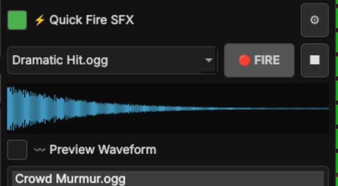

# SFX and Quick Fire

There are two kinds of sound effects. Both play **on top of** the music.

## SFX: sounds that loop

Think rain, a crowded tavern, a ticking machine. **SFX Play** starts the selected sound and **loops it until you stop it**.

* Choose the source with **Use SFX from Folder** (the scene's own `sfx` folder) or untick it to use your SFX library
  (a folder sorted into categories like *Weather* or *Dungeon*).
* **Double-click** a sound, or select it and press **💥 SFX Play**. **Stop** ends it.
* The orange text above the buttons shows what is playing. The slider sets the SFX volume (saved per scene).
* **〰️ Preview Waveform** shows the shape of the sound.
* The SFX list can be dragged into your order, and linked to other scenes.

## ⚡ Quick Fire: sounds for the moment

Tick **⚡ Quick Fire SFX** to open a small row for **one-shot** sounds: a sword clang, a dramatic hit, a door slam.

1. Click the **⚙** next to it and choose a folder with your quick sounds (each scene can have its own).
2. Pick a sound in the dropdown. Its waveform appears below.
3. Press **🔴 FIRE**, or press **Shift+S** on your keyboard. It plays once.
4. After firing, the dropdown moves to the **next** sound, so you can fire a whole sequence by tapping the key.
5. **■** stops a quick-fire sound.
6. The **🔊 Quick Fire volume** slider sets how loud these sounds are. It is separate from the SFX slider and saved per scene, so you can keep your rain quiet and your sword clang loud.

Quick Fire has its own player and its own volume, so it does not interrupt (or change) your looping SFX or music.

## Master buttons

* **▶ MASTER PLAY (Space)** starts music and SFX.
* **🛑 MASTER STOP (Space)** fades the music out and stops the SFX.
* **Space** on your keyboard toggles between them.
