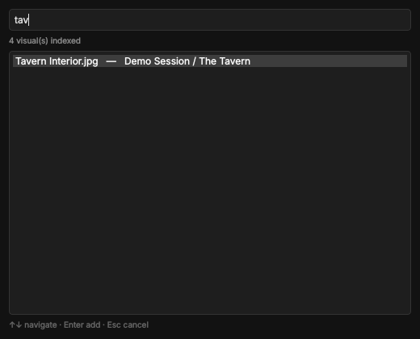
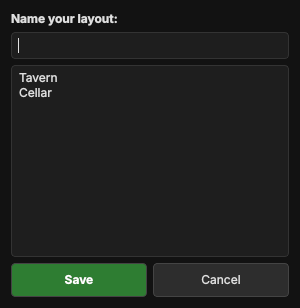

# Visuals, layouts and the stage

This is the part your players actually see.

## Visuals

The **Visuals** panel lists the pictures and videos of the scene (maps, portraits, handouts, battle backgrounds, looping videos).

* **Double-click** a visual to put it on the stage.
* Videos play and loop on the stage, with their own sound.
* Press **Ctrl+Tab** from anywhere to open **Quick Add**. Type a few letters and it searches the visuals of your *whole*
  campaign. Pick one and it is linked into the current scene.

## Working on the stage

The black area in the middle is the **DM Preview**. The **green dashed box** is the projection area: what your players see.
On a 1080p projector, the stage shows exactly that box, so the space around it is your free backstage area.

| You want to | Do this |
|---|---|
| Move a picture | Drag it with the left mouse button |
| Make it bigger or smaller | Hold the **right** mouse button on it and drag left or right |
| Make it see-through | Select it and use the **👻 Ghost** slider in the Management column |
| Bring it forward or back | Select it, then **🔼 Front** or **🔽 Back** |
| Remove it | Select it and press **Delete** |
| See the whole stage again | **🏠 Home (Reset View)** |

## Blanking: hide the secret parts

A **blanking box** is a black rectangle that covers part of the stage. Use it to hide the rest of a map or a surprise.

Blanking is **off by default**, so it doesn't get in your way. Switch it on in the **🔳 Blanking** menu above the stage:

* **In this scene:** turns blanking on for the current scene only.
* **In all scenes:** turns it on everywhere. This is a setting of the app, so it is **remembered for good**, also after a restart.
  While it is on, "In this scene" is ticked and locked. Your per-scene choices are not lost, they come back when you untick it.
* **🔳 Show Blanking:** shows or hides the boxes.
* **➕ Add box (Ctrl+B):** drops a new black box in the middle of the stage.

Once blanking is on:

1. Drag a box to move it. Right-drag to resize it.
2. **Right-click** the box → **⭐ Apply position to layouts…** to copy the box into other layouts you tick.
3. **Delete** removes a selected box.
4. Boxes are saved with your layouts, and come back when you load the layout.

**Nothing gets lost while blanking is off.** Layouts keep the boxes they already have. The tool just doesn't show them
in scenes where blanking is off, and saving a layout there leaves its existing boxes untouched.
Switch blanking on again and the boxes of the loaded layout reappear.

## Drawing on the stage

Need to point at something? Open the **🖌 Annotate** menu above the stage:

* **Brush (Alt+A)** draws a red line. **Rect** draws a transparent red box.
* **Clear (Alt+Shift+A)** wipes the drawing.
* Click the same tool again to switch drawing off. While you draw, the menu button shows a **●**.

Drawings show on the projector too, but they are **not saved** in layouts.

## Layouts

A **layout** is a saved arrangement: which visuals, where, how big, how see-through, in what order, plus your blanking boxes.

* Arrange the stage, then press **Save Current Layout**, give it a name and save. It appears in the **Layouts** list.
  Pick an existing name to overwrite it.
* **Double-click** a layout to load it. The new layout **fades in while the old one fades out**.
  The time is set with **⏱ Fade (s)** above the stage (0 is instant).
* Drag layouts into the order you'll use them. **NEXT LAYOUT** in the mini controls follows this order.
* **+** next to *Layouts* creates a new empty layout. **🔗** links a layout from another place.
* Right-click a layout for **Link to…** and **🗑 Delete Layout**.

