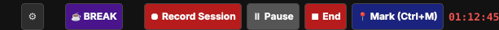

# Recording your session

Record the table talk while you play, and leave **bookmarks** so you can find the good moments later.
It's great for session recaps, or for turning the audio into notes afterwards.

## Start

1. Press **⏺ Record Session**.
2. A small window asks for three things:
   * **Filename:** suggested as today's date plus `_session`. Change it if you like.
   * **Save recordings to folder:** where the files go. The tool remembers it for next time.
   * **Input device:** pick your microphone (the table mic or audio interface).
3. Press **⏺ Start Recording**. The timer in the top right starts counting.

## While recording

| Button | What it does |
|---|---|
| **⏸ Pause / ▶ Resume** | Stops and restarts the recording. The timer blinks while paused. |
| **📍 Mark (Ctrl+M)** | Drops a bookmark at the current time. You can type a short note ("Grimble reveals the secret"), or leave it empty. |
| **⏹ End** | Asks "Stop and finalise?" and then closes the recording. |

The tool also drops **automatic marks** for you when you:

* open another **scene** (`Scene: The Tavern`),
* load a **layout** (`Layout: Tavern + NPC`),
* start or end a **break**.

So later you'll see exactly when the party walked into the tavern, even if you forgot to press anything.

## What you get

In your recording folder you'll find a new folder named like `2026-10-22_session` with:

* `session_part000.wav`, `session_part001.wav`, … The recording is cut into **30-minute pieces**. Each piece is a complete,
  playable file the moment it closes. If the PC crashes, you lose at most the piece you were in.
* `session_markers.json`: your bookmarks with timecodes (`01:12:45`), the file piece they are in, and your notes.
  It also stores the real clock time of start, break and end, which helps if you also filmed the session and want to line things up.

* `session_audio_log.json`: a second list that notes **what played when**: every music track, SFX and Quick Fire sound, with the timecode it started at.
  Handy for finding that one cool fight track again, or for building a track list of the evening. It only writes when something starts, so it costs nothing while you play.

The audio is saved as mono 44.1 kHz WAV (uncompressed), so the files are large: roughly 300 MB per hour. Convert them to MP3 afterwards if you want to archive them.

## Tips

* Pick a **microphone** as the input device. The tool records what that device hears.
* The **Mark** button also lives in the mini controls window, so you can bookmark without switching windows.
* Taking a break? Press **☕ BREAK**. The recording pauses by itself and resumes when the break ends.
